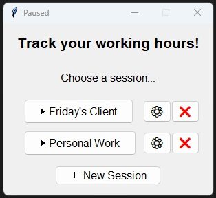
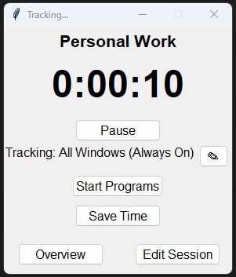
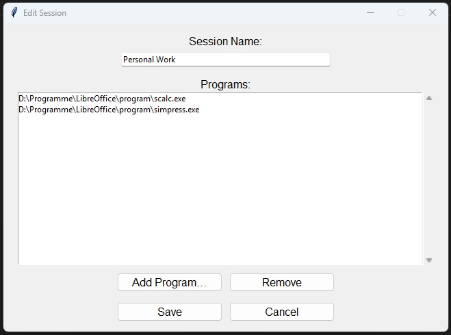

# WorkingHoursTimer
Easily document your working hours!

# Want to do
- each tracker has their own program to be tracked

# Overview of changes
- v1.1
  - shows in overview when the timer was last used
  - shows in overview the cumulative time spent
- v1
  - Sets correct text color on the timer
  - adjusted the design
- v0.8
  - Change the Layout of the Program: lost the "Manage Sessions" window and just uses the overview
  - Timer is automatically paused when starting a session
  - Manage saving the sessions so no time will be overwritten (is added instead)
  - Program asks whether time should be saved before closing the program
- v0.7
  - can now manage multiple sessions, each with their own programs
  - saves are now made under the session name
- v0.6
  - can now add programs to the config and can start them with a button click
- v0.5
  - added saving functionality: logs to timelog.csv using the date and title
  - resets the timer after saving
  - if the current date is already in the timelog file, it adds the tracked time to the time in the file
  - adds a filelock so I can run and save multiple instances
- v0.4
  - Added a pause button
- v0.3
  - added functionality to the timer so it can run without following a specific window (that is, running all the time)
- v0.2
  - added functionality so that the user can input the window name its following
- v0.1
  - simple functionality of a timer running on screen

